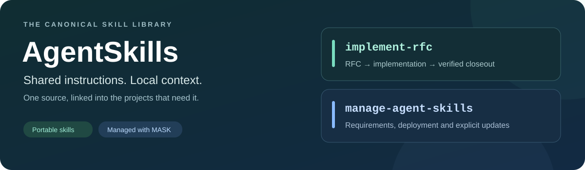

**[Skill catalog](#available-skills) · [Use a skill](#use-the-skills-in-a-project) · [Workflow context](#configure-implement-rfc) · [Author a skill](#author-a-skill) · [Provenance](#provenance-and-current-deployment)**

A private collection of canonical agent skills shared across projects and personal installations. Each skill lives under `skills/<id>/`; projects keep their own requirements and configuration while using directory links to the shared instructions.

The companion [ManageAgentSkills (MASK) repository](https://github.com/MikeMarcin/ManageAgentSkills) contains the CLI that validates packages, manages personal and project links and performs explicit source updates. This repository contains the skill payloads and their authoring workflow.

## Available skills

| Skill | Use it for |
|---|---|
| [author-rfc](skills/author-rfc/SKILL.md) | Draft grounded RFCs/packs, revise supplied designs or propose amendments with a portable implementation handoff. |
| [grill-rfc](skills/grill-rfc/SKILL.md) | Optionally challenge RFC designs while keeping decisions, acceptance and draft artifacts consistent. |
| [grill-me](skills/grill-me/SKILL.md) | Stress-test plans, decisions or ideas through explicit-answer interviews, including nonsoftware topics. |
| [implement-rfc](skills/implement-rfc/SKILL.md) | Carry RFCs or RFC packs through bounded implementation, acceptance verification, commits and issue-board closeout. Requires consumer workflow context. |
| [attended-review](skills/attended-review/SKILL.md) | Prepare protected candidates and save partial human decisions through local HTML, with an offline fallback. |
| [wizard](skills/wizard/SKILL.md) | Guide required manual steps one at a time with durable progress on native Windows and macOS. |
| [manage-agent-skills](skills/manage-agent-skills/SKILL.md) | Inspect and manage personal and project selections through MASK's JSON CLI. |
| [coauthoring](skills/coauthoring/SKILL.md) | Collaborate on long-form prose while preserving the author’s voice. |
| [code-simplifier](skills/code-simplifier/SKILL.md) | Simplify touched code while preserving behavior and local conventions. |
| [technical-book-humanizer](skills/technical-book-humanizer/SKILL.md) | Revise technical prose for precision, stance and an experienced engineering voice. |
| [writing-for-agents](skills/writing-for-agents/SKILL.md) | Write and review skills, AGENTS.md files and other instructions agents consume. |
| [instamat-image-to-pbr](skills/instamat-image-to-pbr/SKILL.md) | Prepare and review PBR texture maps with the InstaMAT Pipeline CLI. |
| [trellis-image-to-3d](skills/trellis-image-to-3d/SKILL.md) | Prepare images and use hosted TRELLIS providers, with offline validation and optional ExampleWorkflow receipts. |
| [pr-tour](skills/pr-tour/SKILL.md) | Build, edit, rehearse or resume an author's guided GitHub pull-request tour through the `bpr tour` CLI, without publishing on the author's behalf. |
| [concept-art-approval-pipeline](skills/concept-art-approval-pipeline/SKILL.md) | Produce and review concept-art candidates with exact, persistent approval records. |
| [sprite-sheet-animation-updater](skills/sprite-sheet-animation-updater/SKILL.md) | Preserve character identity and validate fixed-cell sprite animation layouts. |

`implement-rfc` was imported first with the supplied seed provenance preserved. `manage-agent-skills` was added after the CLI contracts were verified. Source membership and deployment scope are separate. MASK user commands explicitly select personal skills; project declarations continue to select project workflows.

## Use the skills in a project

Clone this repository and install MASK using its [setup guide](https://github.com/MikeMarcin/ManageAgentSkills#install-once). MASK requires Python 3.11+, Git and native directory symlink support. If its launcher is unavailable, use a known supported interpreter with `/absolute/path/to/ManageAgentSkills/mask.py`.

Approve the tap and preview the requested installation. Replace the project path
with your own:

```sh
mask tap agentskills https://github.com/MikeMarcin/AgentSkills.git --json
mask search --json
mask install manage-agent-skills --project /absolute/path/to/project --dry-run --json
```

Review the proposed actions and use the returned `data.plan_hash`:

```sh
mask install manage-agent-skills --project /absolute/path/to/project --approve-plan RETURNED_HASH --json
mask status --project /absolute/path/to/project --check --json
```

`install` and `uninstall` preserve unrelated selections. `register` prepares an
existing declaration in a fresh clone or worktree.

Commit `.mask.json` and consumer context; ignore generated entries under `.agents/skills/` and `.claude/skills/`. Preserve unrelated real skills.

## Personal selections and project context

Use `mask install ID --user --dry-run --json`, followed by the same command with
`--approve-plan HASH` instead of `--dry-run`, to select personal skills.
Inspect with `mask list --user --json` and `mask status --user --check --json`.

The initial personal selection is coauthoring, code-simplifier,
technical-book-humanizer, instamat-image-to-pbr, and manage-agent-skills.
TRELLIS and concept-art approval are selected by sample_studio; sprite animation is
selected by SampleAssets. These three are not personal defaults.

Consumer-specific paths and behavior belong in
`.mask/skill-config/<skill-id>/project.md`. SAMPLE_STUDIO owns its concept-art ExampleScene
profile. AST owns its SampleCharacter defaults, generator, local validation/build wrapper,
and complete contributor documentation. Bundled scripts resolve relative to the
installed skill, while consumer paths resolve relative to the consumer.

## Configure implement-rfc

For proposals, use `author-rfc`, optionally `grill-rfc`, then `implement-rfc` for
authorized execution. `grill-me` supplies shared interview mechanics. Grilling is
optional per task; drafting confirmation adds no implementation gate. Complete
portable authoring uses implement-rfc's existing offline kit. RFC grilling requires
author-rfc and grill-me; resolve companions by skill name in the current host.
`author-rfc` also uses implement-rfc's portable plan kit. The flat `agentskills/rfc`
bundle selects all four companions: author-rfc, grill-rfc, grill-me and implement-rfc.
After approving the tap and configuring the consumer context below, fetch its catalog
and review this installation:

```sh
mask tap fetch agentskills --json
mask bundle show agentskills/rfc --json
mask bundle apply agentskills/rfc --project /absolute/path/to/project --dry-run --json
mask bundle apply agentskills/rfc --project /absolute/path/to/project --approve-plan RETURNED_HASH --json
mask status --project /absolute/path/to/project --check --json
```

The review includes implement-rfc's required native-role setup. Bundle apply preserves
manual selections and exact locks; future definition changes require an explicit
`mask bundle refresh agentskills/rfc --dry-run` review. Each skill remains individually
installable with `mask install agentskills/SKILL`. The source index lists every existing
package; adding this bundle does not change real project or personal selections here.

New runs default to `coordinator-implementer`: a low-effort coordinator and one fresh
provider-routed `rfc-implementer` per milestone or post-review engineering round.
The implementer owns planning, coding, checks, integration and upkeep; the coordinator
advances milestones and owns attended-review hand-back watches. No additional agents
are dispatched. Explicit
strategy choices and preserved runs retain their selection; see
[strategy selection](skills/implement-rfc/references/strategy-selection.md).

> [!IMPORTANT]
> `implement-rfc` needs the consumer’s own repository facts and rules. A deployed link alone does not configure the workflow.

The workflow reads exactly two consumer-specific files:

```text
<project>/.mask/skill-config/implement-rfc/project.json
<project>/.mask/skill-config/implement-rfc/project.md
```

Use this repository's [project configuration](.mask/skill-config/implement-rfc/project.json) and [project rules](.mask/skill-config/implement-rfc/project.md) as structural examples. Adapt the complete repository identity, paths, issue lanes, verification commands and rules to the consumer. Do not copy another project's facts unchanged or embed them in the shared skill. The [inherited example](skills/implement-rfc/examples/projects/sample-review/) is historical reference, not an active default.

After configuring the consumer, deploy `implement-rfc` with the same preview/guard sequence above. Verify selection and inspect the board through the linked workflow:

```sh
python3 /absolute/path/to/project/.agents/skills/implement-rfc/scripts/project_config.py --repo-root /absolute/path/to/project
python3 /absolute/path/to/project/.agents/skills/implement-rfc/scripts/audit_board.py --repo-root /absolute/path/to/project
```

The resolver selects an explicit `--repo-root` first, then `IMPLEMENT_RFC_PROJECT_ROOT`, then the invocation working directory's Git worktree root. Missing or mismatched context refuses. It does not select a consumer from the resolved skill symlink. Cards use the canonical multi-RFC schema; see the [board command contract](skills/implement-rfc/references/bookkeeping.md). Native role adapters are optional and generated separately; see the [workflow instructions](skills/implement-rfc/SKILL.md).

## Author a skill

Create `skills/<id>/SKILL.md` with matching frontmatter:

```markdown
---
name: example-skill
description: Describe the task this skill handles and when to use it.
---

# Example skill

Write the instructions an agent needs to perform the task.
```

Use a portable lowercase ID such as `example-skill`. MASK's package convention accepts single-line plain or quoted `name` and `description` scalars. Keep supporting files inside the package; linked, special and case-colliding entries are rejected. Validation is passive and does not execute skill code. [writing-for-agents](skills/writing-for-agents/SKILL.md) covers writing the description and instructions.

Edit canonical files here, leaving project-specific facts in consumer context. Validate the package with `mask skill validate example-skill --json` against a machine configured to use this checkout. To inspect every package, use `mask skill validate --all --json`.

For changes to the shared workflow, run this check from the repository root:

```sh
python3 -B skills/implement-rfc/scripts/validate_portable_agents.py --source-only
```

Check the management procedure's public CLI examples against the selected MASK checkout with:

```sh
python3 -B scripts/verify_mask_examples.py --mask-program /absolute/path/to/ManageAgentSkills
```

The example scenario uses disposable projects and local bare remotes. Run `python3 -B scripts/verify_documentation.py` for the issue/RFC structure gate, and choose focused helper tests for the behavior being changed. Follow [CONTRIBUTING.md](CONTRIBUTING.md), the [RFC tracker](docs/rfcs/README.md) and the [issue board](docs/issues/README.md).

## Updates and ownership

> [!NOTE]
> Development links observe local source edits. Normal installations use locked
> artifacts; `mask upgrade` selects newer versions and prepares them. Running hosts
> may need a restart to load changed skills.

Use `mask update` to refresh MASK and tap catalogs. Preview `mask upgrade --dry-run`
for the current checkout, then apply the reviewed plan with `--approve-plan HASH`.
Add `--user` for personal skills or `--all` for every registered checkout plus
personal skills. Version holds survive upgrade; required setup still reconciles.

Do not edit MASK's internal registry or delete a real skill directory to bypass a collision. `unregister PATH` removes only unchanged owned links and leaves the declaration and source intact. For interrupted operations, inspect `recover --inspect` before choosing a recovery action.

## Provenance and current deployment

AgentSkills, ManageAgentSkills, SampleReview, SampleLogs, SamplePlanner and sample_studio declare implement-rfc, attended-review and wizard through MASK, with distinct consumer context. AgentSkills and MASK also declare manage-agent-skills. Verified original copies remain outside discovery roots in `.mask/bootstrap-retired/`. Generated links, adapters and backups are ignored; skill payloads, declarations and project context are versioned.

See [skill provenance](docs/development/skill-provenance.md), the [dogfood record](docs/development/mask-dogfood.md) and the [retained packet assets](docs/rfcs/assets/mask-v1-2026-09-05/). Repository visibility and inherited-source licensing remain unchanged. Filesystem links and bounded script invocation have been verified; they do not establish that an already-running agent has loaded a skill.

The [selected skill migration record](docs/development/selected-skill-migration-2026-09-05.md) records personal/sample_studio/AST ownership, retained backups, consumer commits, and actual verification.
