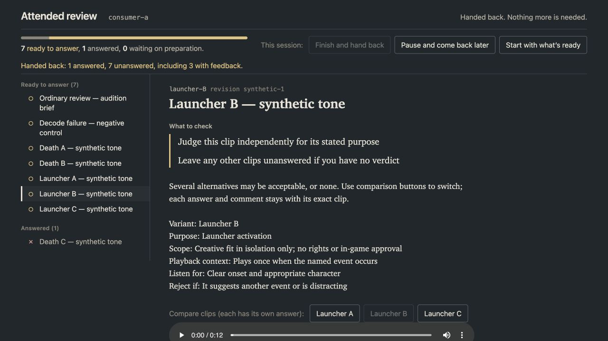
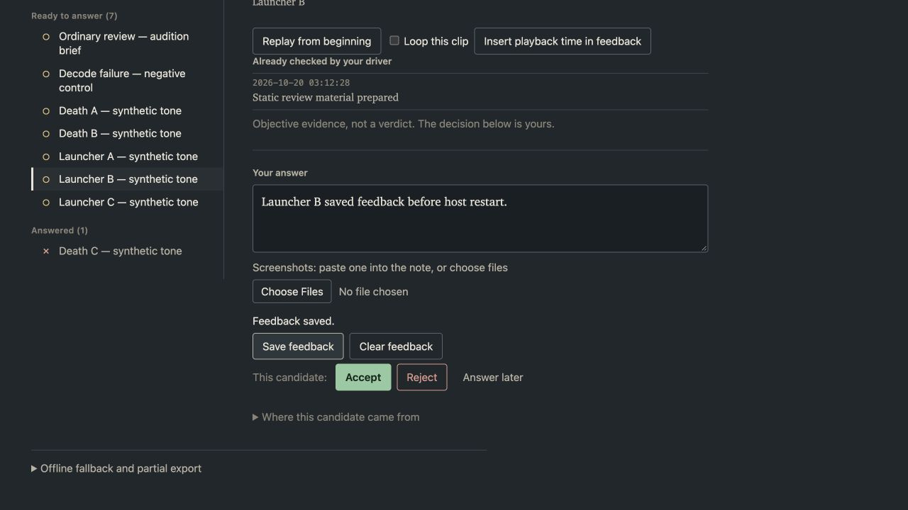

# Root browser observations — audio questions

Observed by the coordinator in Codex's in-app browser on 2026-10-19 (America/Los_Angeles).
These are automated fixture interactions, not human creative approval, listening
judgment, rights clearance or in-game acceptance. Fixtures use synthetic tones.

The implementer's disposable consumer-a host was opened through its complete local
URL. No Faraday host, package or review state was touched. Host tokens are omitted
from this record.

## Live observations

- One queue contained an ordinary brief, six launcher/death alternatives and a
  deliberate decode-failure control. Each question retained its own answer.
- Text entered into the ordinary question before any verdict survived navigation
  to an audio question and a later full page reload.
- Launcher A feedback survived A/B navigation. The queue still showed eight ready,
  zero answered after feedback was saved. Launcher B initially had empty feedback.
- During Launcher A playback, its currentTime advanced from 0.193397 to 4.027812
  seconds while feedback moved from waiting to saved. The player remained unpaused,
  the note retained its text and DOM focus remained on `#note`.
- Loop enabled the player's loop property. Replay reset playback near zero, and
  Insert playback time appended `[0:00.0]` to ordinary text feedback.
- Selecting Launcher B left a single player at time zero, paused, with B's own
  feedback. Returning to A restored A's comment. No automatic answer was inferred.
- Death C was rejected with the text "Reject for death; consider this for non-death
  pain." The UI showed one answered and seven ready, leaving siblings undecided.
- Editing and saving the Death C note kept its rejection. Clearing the answer
  returned the queue to zero answered and retained the revised feedback. Full reload
  and return to Death C recovered that feedback. The fixture then re-recorded its
  rejection for the handback scenario.
- The broken media control displayed "Could not load or decode ... Playback has
  not succeeded." It remained unanswered and its diagnostic appeared in export.

## Failed-save recovery

Launcher B first saved "Launcher B saved feedback before host restart." The
implementer then cleanly stopped only this disposable host. A new edit, "Launcher B
recoverable edit while the host is stopped.", produced an explicit failed-fetch
notice and "Save failed. Your local draft is retained. Retry Save feedback or export
it." The newer text remained in the form; the page did not claim it was saved.

The UI's Export answers and feedback action produced a version-2 partial packet
containing the unanswered Launcher B draft, ordinary/Launcher A feedback, the Death C
rejection with its revised note, and the decode diagnostic. The rendered JSON was
saved to the fixture's `browser-recovery-export.json` for public-CLI import and
idempotence checks by the implementer. This checks export recovery across a host
restart; it does not claim automatic retry across a changed browser origin.

The implementer confirmed that durable state still held the earlier Launcher B
comment before import. Importing the UI packet changed only Launcher B feedback;
re-import was a no-op at sequence 38. Opening the restarted host's complete URL
showed the recovered newer Launcher B comment with seven pending and one rejected
question. The ordinary pre-verdict comment also remained present after restart.

Finally, Launcher B was played and Finish and hand back was pressed. The player
stopped (`paused: true`, currentTime 0.026255). The UI reported "Handed back: 1
answered, 7 unanswered, including 3 with feedback." The recovered comment remained
visible and answer/feedback mutation controls were disabled. The implementer owns
the separate durable event/protection and host-wait corroboration.

## Browser qualification limit

Opening consumer-b's generated offline HTML via `file://` was refused by the browser
security policy, which permits HTTP/HTTPS only. No alternate browser surface or HTTP
file-serving workaround was used. Direct native offline-file playback is unverified.
The implementer's separate deterministic offline tests must be reported as such;
live shared-control observations do not establish native file-URL qualification.

## Committed-candidate smoke

After source candidate `2eff4c3` changed status/editor retry handling during
self-review, one narrow smoke check used the independent consumer-b host with that
committed source. Launcher A playback advanced from 0.244098 to 3.308371 seconds
while its new comment autosaved. Playback stayed unpaused, `#note` retained focus
and text, and the queue stayed at eight ready/zero answered. Comparing to Launcher B
and back restored A's comment. Partial export contained version 2, zero decisions,
and exactly the saved Launcher A feedback. This covers the changed save/status path
without repeating the whole earlier review. The browser tab was closed afterward;
the implementer owns stopping the disposable host.

## Screenshot

The screenshots show the context/comparison controls, independent queue and shared
feedback/answer controls. They contain no host token. Final source identity and
durable-state corroboration belong to the implementer's acceptance record.
